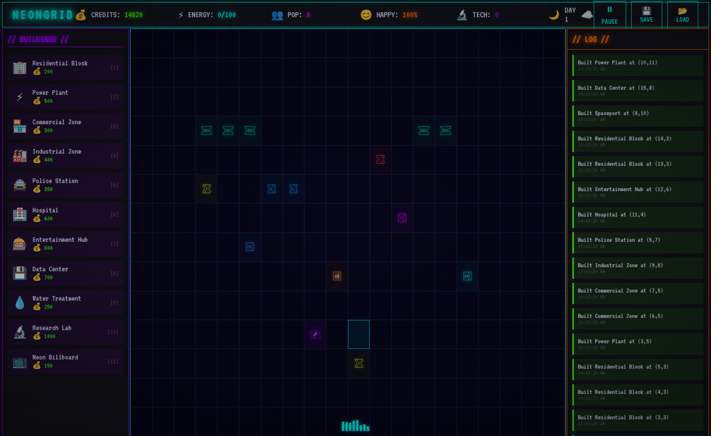

# NeonGrid

A cyberpunk city-builder that runs in the browser, written in plain HTML, CSS and JavaScript with no frameworks or build step. Place buildings on a grid, balance credits, energy, population and happiness, survive random events, and research upgrades through a small tech tree.

**Play it:** https://mizoz.github.io/neongrid/



## Features

- **16 building types**, each with its own cost, upkeep and effect on energy, population, happiness, credits and tech
- **Real-time simulation** on a one-second tick: income, energy balance, population growth and happiness
- **Day/night cycle and weather** (clear, rain, storms, snow)
- **12 random events**, including power outages, cyber attacks, alien invasions, trade deals and tech breakthroughs
- **Tech tree** with three branches (Infrastructure, Energy, Society) that unlock advanced buildings
- **15 achievements**, from "First Building" to "Cyberpunk Legend"
- **Save and load** your city as a JSON file, plus periodic auto-save
- **Retro sound effects** made with the Web Audio API
- Terminal-style neon interface with ASCII-art building tiles

## How to play

Open the [live version](https://mizoz.github.io/neongrid/), or run it locally:

```bash
git clone https://github.com/mizoz/neongrid.git
cd neongrid
# open index.html in a browser, or serve the folder:
python3 -m http.server 8000   # then visit http://localhost:8000
```

`neongrid.html` is a self-contained single-file build of the same game that you can open directly or share as one file.

### Controls

| Input | Action |
| --- | --- |
| Click a building, then click the grid | Place a building |
| `1`–`9` | Quick-select the first nine buildings |
| `Space` | Pause / resume |
| `S` / `L` | Save / load |
| `Esc` | Cancel placement |

### Tips

- Build a Power Plant early; most buildings draw energy.
- Residential Blocks add population capacity; Water Treatment helps it grow.
- Industrial and Black Market buildings make money but cost happiness, so balance them with Police, Hospitals and Entertainment.
- Research Labs and Data Centers generate tech for the tech tree.

## Project structure

```
index.html      # entry point (modular version)
css/style.css   # terminal / neon styling
js/game.js      # game state, buildings, events, tech tree, achievements, save/load
neongrid.html   # single-file version of the whole game
```

## Tech stack

HTML, CSS and vanilla JavaScript (DOM rendering, `setInterval` game loop, Web Audio API, File API for save/load). Hosted on GitHub Pages.

## License

MIT © 2026 Ahmed Mahmoud. See [LICENSE](LICENSE).
